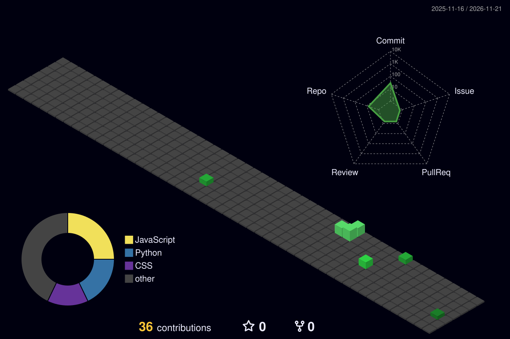

<!-- ================= HERO SECTION ================= -->

<div align="center">


<br/>

<a href="https://github.com/Preethireddy-017">

</a>


</div>

---

<!-- ================= ABOUT ME ================= -->

## 💫 ABOUT ME

```python
class Developer:

    def __init__(self):
        self.name = "Preethi Reddy"
        self.education = "MCA Graduate - 2025"
        self.role = "Python Full Stack Developer"
        self.languages = ["Python", "JavaScript"]
        self.frontend = ["HTML", "CSS", "React"]
        self.backend = ["Django", "Django REST Framework"]
        self.database = ["MySQL"]
        self.tools = ["Git", "GitHub", "VS Code"]

    def current_focus(self):
        return [
            "Building Full Stack Applications",
            "Learning REST API Development",
            "Improving Problem Solving Skills",
            "Writing Clean and Maintainable Code"
        ]

developer = Developer()
```

- 🎓 MCA Graduate (2025)
- 💻 Interested in Full Stack Web Development
- 🌱 Learning React and Django REST Framework
- 🚀 Building practical development projects
- 🎯 Goal: Grow as a professional Python Full Stack Developer

---

<!-- ================= TECH STACK ================= -->

## ⚡ TECHNOLOGY STACK

### Programming Languages

<p>

</p>

### Frontend Development

<p>

</p>

### Backend Development

<p>

</p>

### Database & Developer Tools

<p>

</p>

---

<!-- ================= PROJECTS ================= -->

## 🚀 FEATURED PROJECTS

<table>
<tr>
<td width="50%">

### 🏥 Doctor Appointment System

**Full Stack Development**

- Patient and doctor modules
- Appointment management
- JWT authentication
- REST API integration

**Tech:** React, Django REST Framework, MySQL

<a href="https://github.com/Preethireddy-017/Doctor_Appointment_System">View Repository →</a>

</td>
<td width="50%">

### 🥦 Vegetable Inventory System

**Backend Development**

- Inventory management
- CRUD operations
- Stock management
- MySQL database integration

**Tech:** Python, MySQL

</td>
</tr>

<tr>
<td width="50%">

### 🎬 Movie Ticket Booking

**Python Application**

- Movie ticket booking
- User input validation
- Booking management

**Tech:** Python

<a href="https://github.com/Preethireddy-017/Movie-ticket-booking-system">View Repository</a>

</td>
<td width="50%">

### 🎓 Student Management System

**Frontend Development**

- Student information interface
- Interactive web pages
- JavaScript functionality

**Tech:** HTML, CSS, JavaScript

<a href="https://github.com/Preethireddy-017/Student-management-system">View Repository</a>

</td>
</tr>
</table>

---

<!-- ================= GITHUB ANALYTICS ================= -->

## 📊 GITHUB ANALYTICS

<div align="center">


<br/><br/>


</div>

---

<!-- ================= 3D CONTRIBUTIONS ================= -->

## 🌌 3D CONTRIBUTION GRAPH

<div align="center">



</div>

---

<!-- ================= CONTRIBUTION SNAKE ================= -->

## 🐍 CONTRIBUTION SNAKE

<div align="center">


</div>

---

<!-- ================= CURRENT FOCUS ================= -->

## 🎯 CURRENT FOCUS

- [x] Python Full Stack Training
- [x] Python and MySQL Practice
- [ ] Advanced React Development
- [ ] Django REST Framework
- [ ] Building Real-World Applications
- [ ] Improving Data Structures and Algorithms

---

<!-- ================= FOOTER ================= -->

<div align="center">

### 💡 CODE. LEARN. BUILD. REPEAT.


</div>
